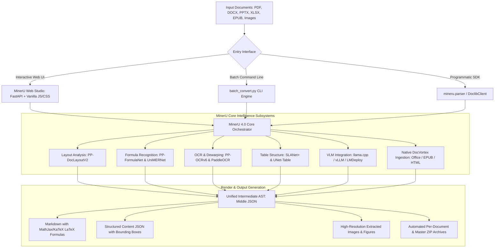

<div align="center">
<p align="center">
  
</p>

# MinerU 4.0 & Web Studio Enterprise Suite

[](https://www.python.org/)
[](https://fastapi.tiangolo.com/)
[](https://github.com/opendatalab/MinerU)
[](https://pytorch.org/)
[](LICENSE.md)
[](https://github.com/opendatalab/MinerU)

[English](README.md) | [简体中文](README_zh-CN.md)

</div>

---

An enterprise-grade document extraction, OCR, mathematical formula parsing, and layout analysis workstation. This profile couples the deep document intelligence of **MinerU 4.0** with a custom **FastAPI Web Studio** graphical interface and a multi-threaded **Batch Conversion CLI** engine with automated ZIP archiving.

---

## Table of Contents

1. [System Architecture](#system-architecture)
2. [Complete Profile Directory & File Map](#complete-profile-directory--file-map)
3. [Quick Start Guide](#quick-start-guide)
4. [MinerU Web Studio (Interactive UI)](#mineru-web-studio-interactive-ui)
5. [High-Throughput Batch Converter CLI](#high-throughput-batch-converter-cli)
6. [Supported Document Formats](#supported-document-formats)
7. [Parsing Tiers & OCR Engine Configuration](#parsing-tiers--ocr-engine-configuration)
8. [Python SDK Usage](#python-sdk-usage)
9. [MinerU Core Subsystems Deep Dive](#mineru-core-subsystems-deep-dive)
10. [Configuration & Model Management](#configuration--model-management)
11. [Troubleshooting & FAQs](#troubleshooting--faqs)

---

## System Architecture



---

## Complete Profile Directory & File Map

Every file and directory in this workspace serves a dedicated role in the document processing pipeline:

```
pdf to md/
├── run_app.bat                      # 1-Click Windows launcher for Web Studio (launches browser & server)
├── run_web_app.py                   # Root Python launcher forwarding execution to MinerU/run_web_app.py
├── batch_convert.py                 # Root CLI launcher forwarding arguments to MinerU/batch_convert.py
├── README.md                        # Master workspace documentation
└── MinerU/                          # Core MinerU repository and application modules
    ├── run_web_app.py               # Web Studio server runner (FastAPI via Uvicorn with auto browser launch)
    ├── batch_convert.py             # Full-featured batch converter CLI with multi-format and ZIP capabilities
    ├── update_version.py            # Automated semantic version updater script
    ├── pyproject.toml               # Python project configuration, dependencies, and CLI entry points
    ├── pyrightconfig.json           # Pyright static type checker configuration
    ├── mkdocs.yml                   # MkDocs documentation site structure and theme setup
    ├── mineru.template.json         # Base configuration template for models, device, and OCR engines
    ├── CLAUDE.md                    # Developer guidelines, Ruff linter rules, and code architecture standards
    ├── AGENTS.md                    # Agentic guidance pointer linking to CLAUDE.md
    ├── LICENSE.md                   # MinerU Open-Source License terms
    ├── MinerU_CLA.md                # Contributor License Agreement documentation
    ├── SECURITY.md                  # Security policies and vulnerability reporting procedures
    │
    ├── web_app/                     # Custom Full-Stack Web Studio Application
    │   ├── __init__.py              # Package marker
    │   ├── app.py                   # FastAPI backend (REST API, SSE/polling batch tasks, file serving)
    │   ├── templates/
    │   │   └── index.html           # Modern responsive dashboard (Drag & Drop, KaTeX viewer, Batch manager)
    │   ├── static/
    │   │   ├── css/
    │   │   │   └── style.css        # Premium dark/light design system, glassmorphism, responsive grid
    │   │   └── js/
    │   │       └── app.js           # Frontend logic (drag & drop, live progress, KaTeX rendering, ZIP export)
    │   └── storage/                 # Workspace directory for uploads, converted markdown, JSON, and media
    │
    ├── mineru/                      # Core MinerU 4.0 Library Subsystems
    │   ├── __init__.py              # Package exports (DoclibClient, mineru version, public APIs)
    │   ├── config.py                # Configuration loader, model paths, and environment resolvers
    │   ├── errors.py                # Custom MinerU exceptions and error codes
    │   ├── filetypes.py             # File format registry and extension mapping
    │   ├── types.py                 # Pydantic data schemas and AST types
    │   ├── version.py               # Engine version constant
    │   ├── backend/                 # Layout analysis and document extraction backends
    │   │   ├── analyze.py           # Analysis orchestrator
    │   │   ├── analysis/            # Format analyzers (PDF, Office, EPUB, HTML, CSV, OFD)
    │   │   │   └── pdf/             # PDF-specific layout, formula, image, OCR, and table analyzers
    │   │   └── postprocess/         # Title hierarchy leveling, LLM postprocessing, and table merge
    │   ├── cli/                     # CLI commands for the mineru document library and server
    │   ├── doclib/                  # Local document database, SQLite full-text search, background daemons
    │   ├── integrations/            # Third-party integrations (DocVortex native parser bridge)
    │   ├── kit/                     # Built-in utilities (Gradio WebUI, API router, VLM server bridges)
    │   ├── model/                   # Deep learning model inference architectures
    │   │   ├── download.py          # Automatic model downloader (Hugging Face / ModelScope)
    │   │   ├── registry.py          # Model registry and lifecycle manager
    │   │   ├── layout/              # PP-DocLayoutV2 layout detector (PyTorch & ONNX)
    │   │   ├── mfr/                 # Mathematical Formula Recognition (PP-FormulaNet & UniMERNet)
    │   │   ├── ocr/                 # OCR detection and recognition models (PP-OCRv6)
    │   │   ├── table/               # Table structure extraction (SLANet+ & UNet-Table)
    │   │   ├── vlm/                 # Vision-Language Model runtimes (llama.cpp, vLLM, LMDeploy)
    │   │   └── runtime/             # Hardware acceleration backends (CUDA, MPS, ONNX, CPU)
    │   ├── parser/                  # Document parsing coordinator, tier dispatch, and data writers
    │   ├── render/                  # Multi-target output renderers (Markdown, LaTeX, HTML, DOCX, EPUB, JSON)
    │   ├── resources/               # Embedded static assets, fonts, character dictionaries, and UI styles
    │   └── utils/                   # Async utilities, logging (Loguru), CLI parsers, and localization
    │
    ├── demo/                        # Developer Examples & Sample Assets
    │   ├── demo.py                  # Python SDK conversion example script
    │   └── pdfs/                    # Sample PDF documents for validation and testing
    │
    ├── docker/                      # Containerized Deployment Configurations
    │   ├── compose.yaml             # Docker Compose orchestration file
    │   ├── china/                   # Docker build tuned for mainland China network mirrors
    │   └── global/                  # Global Docker build using standard PyPI and Hugging Face mirrors
    │
    ├── docs/                        # Complete Documentation Sources (MkDocs Markdown guides)
    ├── projects/                    # Downstream ecosystem integration guides and references
    ├── scripts/                     # Performance benchmarks, ONNX model exporters, and validation tools
    ├── skills/                      # Antigravity agentic skill definitions (mineru/SKILL.md)
    ├── tests/                       # Unit test suite, integration tests, and test fixtures
    ├── tools/                       # DocVortex boundary inspection and format validation scripts
    └── test_output_batch/           # Sample batch conversion outputs and generated ZIP archives
```

---

## Quick Start Guide

### 1. Launching MinerU Web Studio (Graphical Dashboard)

#### On Windows:
Double-click the root batch script:
```cmd
run_app.bat
```
*This automatically activates the local virtual environment, starts the FastAPI server at `http://127.0.0.1:8000`, and opens your default web browser.*

#### Via Python (Windows, macOS, or Linux):
```bash
# Run from workspace root
python run_web_app.py
```
Or directly from the `MinerU` subfolder:
```bash
cd MinerU
python run_web_app.py
```

---

### 2. Running Batch Conversions from the Command Line

Convert an entire folder of PDF, Word, Excel, PowerPoint, or image files with a single command:

```bash
# Basic conversion with individual ZIP creation
python batch_convert.py -i "C:/path/to/documents" -o "C:/path/to/output" --zip

# Recursive folder scan with standard tier and master bundle ZIP
python batch_convert.py -i "./demo/pdfs" -o "./test_output_batch" --tier standard -r --master-zip

# Fast conversion for digital PDFs (skips heavy OCR)
python batch_convert.py -i "./input_folder" -o "./output_folder" --tier flash --skip-existing
```

---

## MinerU Web Studio (Interactive UI)

The Web Studio is a custom FastAPI application providing an intuitive visual interface for document conversion.

### Key Capabilities:
- **Drag-and-Drop Ingestion**: Instant file upload with live validation of supported file extensions.
- **Interactive Parsing Controls**:
  - **Tier Selector**: Choose between `Flash`, `Basic`, `Standard`, and `Advanced`.
  - **OCR Mode**: Select `Auto` (smart detect), `Force OCR` (scanned documents), or `Text Only` (vector text).
  - **Page Range Filter**: Parse specific pages (e.g., `1-5, 8, 11-end`) or process the complete document.
- **Multi-Tab Document Inspector**:
  - **Rendered View**: Formatted Markdown with rich KaTeX mathematical equation rendering and syntax highlighting.
  - **Raw Markdown View**: Full source Markdown with a 1-click clipboard copy button.
  - **Extracted Images Gallery**: Visual grid of all charts, tables, equations, and diagrams extracted from the document.
  - **Middle JSON AST**: Interactive tree view of the intermediate document syntax representation.
  - **Structured Content**: Bounding-box and locator metadata for downstream RAG and LLM citation pipelines.
- **Batch Directory Manager**:
  - Scan any local server directory to discover convertible documents.
  - Start asynchronous background conversion jobs with a live progress bar.
  - Download individual document ZIPs or download the consolidated **Master ZIP archive**.

### REST API Endpoints:

| Method | Endpoint | Description |
|---|---|---|
| `GET` | `/` | Serves the single-page application dashboard |
| `GET` | `/api/health` | Hardware acceleration telemetry (CUDA / MPS / CPU) |
| `POST` | `/api/convert` | Upload a single document for synchronous conversion |
| `POST` | `/api/batch/scan` | Scan a directory path for supported documents |
| `POST` | `/api/batch/start` | Start an asynchronous background batch conversion job |
| `GET` | `/api/batch/status/{task_id}` | Poll progress and status of a batch task |
| `POST` | `/api/batch/cancel/{task_id}` | Terminate an active batch conversion job |
| `GET` | `/api/batch/download/{task_id}` | Download the consolidated master ZIP for a completed batch |
| `GET` | `/api/storage/file/{task_id}/{file}` | Download converted Markdown or JSON files |
| `GET` | `/api/storage/image/{task_id}/{img}` | Serve extracted images and figures |

---

## High-Throughput Batch Converter CLI

The standalone `batch_convert.py` tool automates mass document conversion across directories.

### Command-Line Arguments:

```
usage: batch_convert.py [-h] (-i INPUT_DIR | -f FILE) [-o OUTPUT_DIR]
                        [--tier {flash,basic,standard,advanced}]
                        [--ocr-mode {auto,txt,ocr}]
                        [--page-range PAGE_RANGE]
                        [-r] [--zip] [--master-zip] [--skip-existing]
```

| Argument | Shorthand | Default | Description |
|---|---|---|---|
| `--input-dir` | `-i` | None | Path to input directory containing documents |
| `--file` | `-f` | None | Path to a single input document |
| `--output-dir` | `-o` | `./batch_output` | Output base directory for converted artifacts |
| `--tier` | | `standard` | Parsing tier (`flash`, `basic`, `standard`, `advanced`) |
| `--ocr-mode` | | `auto` | OCR strategy (`auto`, `txt`, `ocr`) |
| `--page-range` | | `""` (all) | Page range specification (e.g., `1-10` or `1,3,5-8`) |
| `--recursive` | `-r` | `False` | Search input directory recursively for documents |
| `--zip` | | `True` | Generate an individual `.zip` archive for each document |
| `--master-zip` | | `False` | Generate a single master `.zip` containing all results |
| `--skip-existing` | | `False` | Skip documents whose output folders already exist |

### Output Artifacts:
For each input document (`example.pdf`), the converter creates an isolated output directory containing:
- `markdown.md`: Complete Markdown text with LaTeX formulas.
- `middle_json.json`: Intermediate schema preserving layout blocks and reading order.
- `structured_content.json`: Machine-readable structured block content.
- `model_output.json`: Raw layout detection and OCR coordinates.
- `images/`: High-resolution PNG/JPG files for all extracted figures, tables, and formula crops.
- `example.zip`: Self-contained ZIP archive packaging all the above.

---

## Supported Document Formats

MinerU supports conversion across 15+ file types:

| Category | Extensions | Processing Method |
|---|---|---|
| **PDF Documents** | `.pdf` | Full multi-tier pipeline (DocLayout, OCR, FormulaNet, TableNet) |
| **Microsoft Office** | `.docx`, `.doc`, `.pptx`, `.ppt`, `.xlsx`, `.xls` | High-fidelity native extraction via DocVortex engine |
| **OpenDocument** | `.odt`, `.ods`, `.odp` | Native XML structure extraction |
| **Digital Books** | `.epub`, `.ofd` | Native container and flow analysis |
| **Web Content** | `.html`, `.htm` | Clean semantic DOM parsing |
| **Tabular & Text** | `.csv`, `.tsv`, `.txt` | Structural table formatting & clean reading |
| **Scanned Images** | `.png`, `.jpg`, `.jpeg`, `.webp` | Deep OCR, layout restoration, and text recovery |

---

## Parsing Tiers & OCR Engine Configuration

MinerU provides 4 processing tiers to balance speed and accuracy:

```
+---------------+------------------------+---------------------------------------+
| Tier          | Speed / Cost           | Recommended Use Cases                 |
+---------------+------------------------+---------------------------------------+
| flash         | Blazing Fast (Instant) | Digital PDFs, text search, raw indexing|
| basic         | Fast (Balanced)        | Standard PDFs requiring fast OCR      |
| standard      | High Precision         | Academic papers, math formulas, tables|
| advanced      | Ultra Precision        | Complex multi-column layouts & scans  |
+---------------+------------------------+---------------------------------------+
```

### OCR Strategies:
- **`auto`**: Inspects document text layers. If embedded digital text is clean, it extracts text directly; if pages contain scanned raster images, OCR is automatically engaged.
- **`txt`**: Ignores OCR and extracts only digital text. Best for high-volume indexing of clean digital PDFs.
- **`ocr`**: Forces OCR recognition across every page, ignoring embedded text layers. Essential for watermarked, garbled, or scanned documents.

---

## Python SDK Usage

Integrate document extraction directly into your Python scripts or RAG pipelines:

```python
from pathlib import Path
from mineru.parser import parse
from mineru.parser.writer import FileBasedDataWriter

# Parse a document
result = parse(
    "research_paper.pdf",
    tier="standard",      # 'flash', 'basic', 'standard', 'advanced'
    ocr_mode="auto",       # 'auto', 'txt', 'ocr'
    page_range="1-10",     # Or 'all'
)

# Save Markdown, JSON schemas, and extracted images
output_dir = Path("./output/research_paper")
result.save(FileBasedDataWriter(str(output_dir)))

# Inspect in-memory attributes
print(f"Total pages: {len(result.pages)}")
for page in result.pages:
    print(f"Page {page.page_idx}: {len(page.blocks)} blocks extracted")
```

---

## MinerU Core Subsystems Deep Dive

- **Layout Analysis (`mineru.model.layout`)**: Uses **PP-DocLayoutV2** to detect document elements including titles, paragraphs, tables, figures, captions, and formulas.
- **Mathematical Formula Recognition (`mineru.model.mfr`)**: Powered by **PP-FormulaNet** and **UniMERNet**, converting mathematical equations into clean inline (`$...$`) and block (`$$...$$`) LaTeX syntax.
- **OCR Engine (`mineru.model.ocr`)**: Leverages **PP-OCRv6** with document deskewing, text direction classification, and specialized seal detection.
- **Table Structure Extractor (`mineru.model.table`)**: Employs **SLANet+** and **UNet-Table** to reconstruct complex nested tables, merged cells, and headers into clean Markdown and HTML tables.
- **Vision-Language Model Backends (`mineru.model.vlm`)**: Supports local acceleration via **llama.cpp**, **vLLM**, or **LMDeploy** for multimodal document understanding.

---

## Configuration & Model Management

The runtime configuration is defined in `mineru.template.json` or `~/.mineru/mineru.json`:

```json
{
  "device": "cuda",
  "ocr_engine": "ppocrv6",
  "layout_model": "pp_doclayoutv2",
  "mfr_model": "pp_formulanet_plus_m",
  "table_model": "slanet_plus",
  "models_dir": "~/.mineru/models"
}
```

### Downloading Pretrained Weights:
Models download automatically on first execution. To pre-download all model weights manually:
```bash
mineru-kit models download
```

---

## Troubleshooting & FAQs

### 1. Windows Terminal Encoding / Unicode Display
If you see garbled characters in Windows Command Prompt, switch to UTF-8 code page:
```cmd
chcp 65001
```
*(Both `batch_convert.py` and `run_web_app.py` already configure UTF-8 output streams automatically).*

### 2. GPU Out-of-Memory (OOM) Errors
For low-VRAM GPUs (under 6GB), switch the parsing tier to `basic` or `flash`, or set `device: "cpu"` in your configuration.

### 3. Missing Dependencies
Ensure you have activated the virtual environment:
```cmd
.\.venv\Scripts\activate
pip install -r requirements.txt
```
Or install directly using `uv`:
```bash
uv pip install -e ".[torch]"
```

---

*Authored for the PDF to Markdown & LaTeX Studio workspace.*
